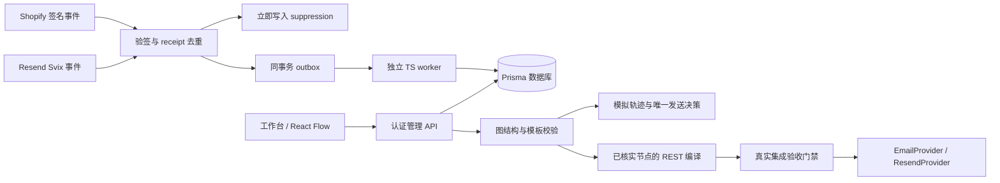

# 架构与实施边界

2026-10-20。本项目为已有加购猫目录中的独立 Next.js 应用，原应用及其部署配置保持原样。

## 技术

Next.js App Router + TypeScript + React 19；React Flow 12，Zustand 负责轻量导航/提示状态；React Email 生成 HTML/文本；Prisma 6.19 的 15 个实体。本地 SQLite 提供无外部服务的持久化演示；等价 PostgreSQL schema/migration 供后续 Preview 验收。使用独立 CSS token 和原生可访问表单，没有引入 Tailwind/shadcn，以减少本次单体 UI 的依赖。

## 数据模型

Store、Contact、ConsentHistory、OrderSummary、AbandonedCheckout、Segment、EmailTemplate、Workflow、WorkflowExecution、EmailEvent、Suppression、WebhookReceipt、OutboxJob、Campaign、AuditLog。

所有实体均带 storeId。Contact 按店铺+规范化邮箱唯一，另存两端 ID。Receipt 按 provider+eventId 唯一，payload hash 冲突拒绝；outbox key 唯一。WorkflowExecution 唯一键为店铺+工作流+业务事件+联系人。EmailEvent 使用店铺+providerEventId 唯一。SQLite/PostgreSQL schema 均保留这些索引。

为了保持两种 DB schema 简洁，实体之间使用显式标识而非 Prisma relation；服务层先校验引用，删除模板/分群时阻止删除已引用资产。后续生产应增加 DB 外键、约束检查和数据一致性巡检。

## 任务与一致性

Webhook 短事务写 receipt、拒发事实和 outbox；负向营销事件在 ACK 前生效，映射失败则关闭店铺 liveEnabled，保留可见审计。网络调用只在 worker 中发生。已完成任务清空 payload，避免长期保留个人信息。

消费者通过 updateMany 比较状态抢占，租约 token 防止旧消费者覆盖新消费者结果；5 分钟过期租约可恢复。网络请求超时 15 秒，429/5xx 退避，最多 5 次死信，运营可重试。当前处理的是可重复的入库/upsert/退订任务；**真实发送不放进这种可盲目重放的任务队列**。长时间同步的租约续期与多消费者 PostgreSQL 压测尚待完成，Preview 应使用单个 worker。

本地模拟采用短事务内去重、许可复查与频率检查。重复请求返回已有 execution，不再创建邮件事实。Campaign 模拟在同事务领取状态并按联系人生成唯一决策。实际投递不可用本地 DB 原子性推断，需要 provider 幂等窗口和未知结果恢复专项测试。

## 流程版本

画布用自有 nodes/edges DSL 保存位置与属性；save 只改 draftJson。模拟发布将草稿复制到 publishedJson，保存版本和时间。接收业务事件时只读取发布快照，手动模拟使用草稿。暂停阻止新的 webhook 业务事件进入发布流程。

六种节点均可编辑和模拟。真实 REST 编译只接受 trigger/send_email/end，终端节点不发给 Resend。condition/delay/wait_for_event 未验证完整 REST 配置与退出语义，编译时明确拒绝，避免生成看似可执行的错误 JSON。模拟会快进时间，本地不实现复杂调度引擎。

## 已有与待完成的 Provider 集成

MockProvider 方法无网络调用；ResendProvider 有 Contacts、Segments、Templates、Automation、Events、Broadcasts 和 Domains REST 边界。Live UI 路径刻意保持 409：没有真实账号、受控邮箱、域名与计费/取消实测，不能完成原 PRD 的真实发信验收。getUsage 显式返回未核实，不编造官方接口或额度。

Shopify token 来自独立服务端环境变量，Store 只存 `env:SHOPIFY_ACCESS_TOKEN` 引用。没有 OAuth 回调/自动 token 续期。必须按安装场景补充对应授权流程。公开店铺域名不能替代后台权限。
